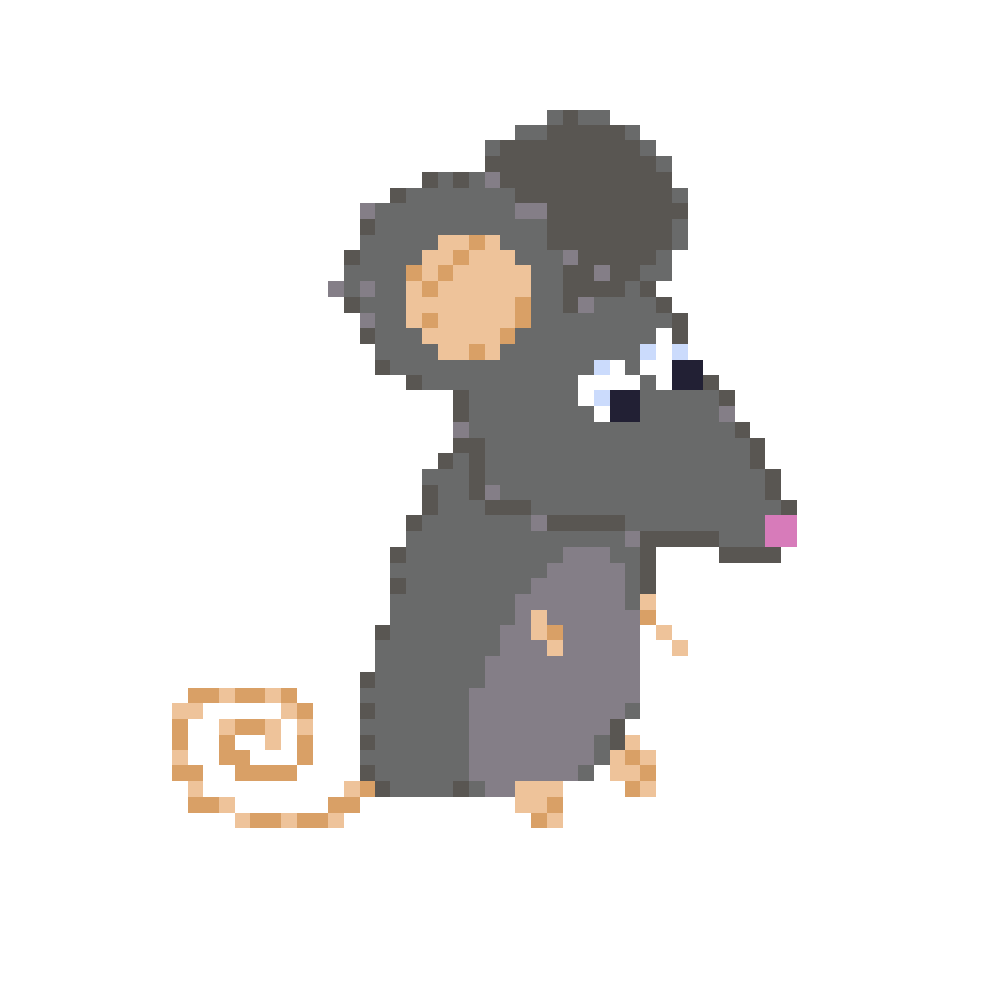

# CurlyDB  
 
### `Dashboard/`

### `Results/`
> Results of QC checks, Data Cleaning and from dashboard

### `Data/`
> See ``Data/README.md`` for details of external datasets used.

### `Database/`
> see `[].dump` to download the full database 

### `renv/`

To ensure reproducibility, we created a renv environment so that our collaborator can use the exact same R and Package versions as us.

## **Noticeboard:**

> DUE DATE: 3rd December (4pm)

- If anyone needs help, message the group chat we're all happy to help :)
- Please let us know if you you need extensions on deadlines
- Will have a meeting 1 week after date of release to check in on Ella/Melissa's progress and address any other issues `Friday 13th November`
- (We can change the name of our database before submission)

---

## **Tasks to be completed/Timeline:**

1. Retrieve data from the TRE ``(Tim)``
2. Create and populate the database  ``(Melissa and Ella - Wednesday November 18th)``
3. Add additional parameter groupings to the database

   > ... minimum 3 but more will garner extra credit. (Will be agreed by all in a meeting after the DB is designed)
4. Design an RShiny dashboard that is robust enough to meet demands of collaborators. ``(Tim and Usman - Monday November 23nd)``
   > Should be able to plot scores of phenotypic data 

   > Should cluster genes for similar phenotype scores

5. Store all scripts and a database backup (.dump) file on GitHub. ``(all - deadline: 3rd December (4pm)
)``
6. Write a <100 word author contribution statement (look up author contribution statements on standard scientific publications.. write in this style) ``(all - deadline: 3rd December (4pm)
)`` 
7. Individual report 
   - 1500 words ``(all - deadline: 3rd December (4pm)
   )``

