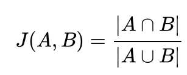

# Initial checks of the data

```{r}
library(ggplot2)
library(dplyr)

setwd("../../")
list.files("Results/Cleaned_Data")


analysis_Data <- read.csv("Results/Cleaned_Data/Cleaned_Data.csv")

parameter_descriptions <- read.csv("Results/Cleaned_Data/Parameters_withGroups.csv")

```

**Number of unique genes in our dataset**

```{r}
length(unique(analysis_Data$gene_accession_id))

```

**It seems most genes have around 7 parameters associated with them before grouping.**

```{r}
params_per_gene <- analysis_Data %>% 
  group_by(gene_accession_id) %>% 
  summarise(
    params = n_distinct(parameter_stable_id)
  )

ggplot(params_per_gene,aes(x=params)) +
  geom_histogram(colour = "black") + 
  xlim(0,quantile(params_per_gene$params,.995))+
  labs(
    y="counts",
    x="Parameters associated with a gene",
    title="Parameters associated with a gene"
  )
remove(params_per_gene)


```

## Multiple Correspondence Analysis

https://medium.com/codex/dimensionality-reduction-techniques-for-categorical-continuous-data-75d2bca53100

- This is a dimensionality reduction technique that represents categorical data in a low-dimensional space where distance between points represents association between variables.

- Starts with a contingency table showing the frequencies of combinations. We then apply PCA to this table.

Because our data is so sparse, we can use Jaccard distance to identify genes with similar scores.



https://medium.com/data-science/hierarchical-clustering-on-categorical-data-in-r-a27e578f2995

analysis_Data %\>%

group_by()

```{r}
sig_level <- 0.05

analysis_Data$significant <-  analysis_Data$p_value < sig_level


mat <- matrix(0,
       nrow = length(unique(analysis_Data$parameter_stable_id)),
       ncol = length(unique(analysis_Data$gene_accession_id))
       )


colnames(mat) <- unique(analysis_Data$gene_symbol)
rownames(mat) <- unique(analysis_Data$parameter_stable_id)


for (gene in unique(analysis_Data$gene_symbol)){
  gene_data <- analysis_Data[which(analysis_Data$gene_symbol==gene),]
  a <- na.omit(gene_data$parameter_stable_id[which(gene_data$significant)])
  mat[a,gene] <- 1
}


View(mat)


```
